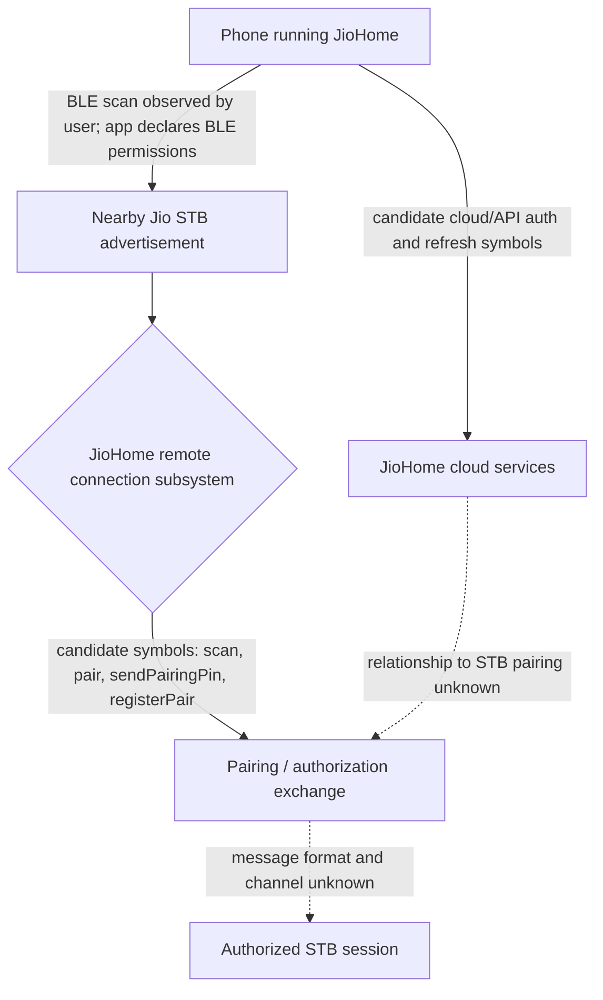
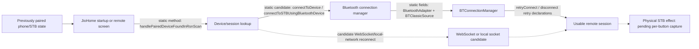
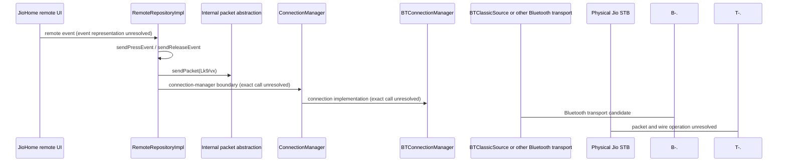
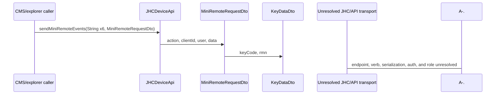
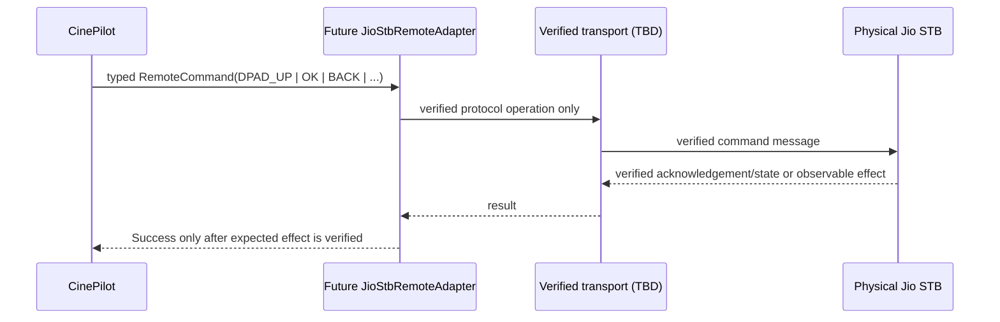

# JioHome Communication and Pairing Flows

These diagrams describe the current evidence boundary. Solid boxes are observed facts; dashed boxes are hypotheses or pending evidence. A diagram is not proof of a transport.

## Pairing / first-use flow

**Confirmed:** BLE discovery is observed by the user; JioHome declares BLE; pairing/reconnection succeeds in the user's normal app flow.

**Not confirmed:** whether pairing payloads are BLE GATT, Bluetooth Classic, local network, cloud-mediated, or hybrid; PIN/token format; exact persistence location.

## Reconnection flow

`handlePairedDeviceFoundInRsnScan`, `connectToDevice`, `BTConnectionManager`, and reconnect methods are statically present. The `BluetoothAdapter` and `BTClassicSource` fields make Bluetooth Classic a concrete transport candidate, but no method-body evidence yet proves that remote key packets use it. The WebSocket/local-network edge remains a candidate only.

## Remote command flow

### Direct remote repository candidate

**Static conclusion:** `RemoteRepositoryImpl` is the strongest current command-dispatch owner. It declares `sendRemoteEvent(String)`, separate press/release methods, `sendPacket(Lk9/vx)`, a `ConnectionManager` accessor, and a 150 ms remote-event delay constant. The lowest identifiable layer is the packet/connection-manager boundary; no concrete byte write or socket send is established.

### Separate CMS/explorer mini-remote candidate

The presence of `keyCode` in this DTO does not prove that the method sends a physical STB command. No static reference currently connects it to `RemoteRepositoryImpl` or `BTConnectionManager`.

Current status: the adapter is intentionally not implemented because the transport and command message are not sufficiently verified.

## Current path assessment

- BLE: **confirmed for discovery visibility; command use unknown**.
- Bluetooth Classic: **concrete static transport candidate** because `BTConnectionManager` owns a `BTClassicSource`; command use remains unconfirmed.
- Local TCP/UDP: **unknown**.
- Local WebSocket: **candidate only**; no command-chain connection established.
- Cloud HTTP/WebSocket: **candidate API path** through `JHCDeviceApi.sendMiniRemoteEvents`; endpoint, authentication, and physical-STB role remain unresolved.
- Direct command dispatch: **strongest current path is `RemoteRepositoryImpl` press/release → `sendPacket` → `ConnectionManager` → `BTConnectionManager`; lowest concrete wire operation is unresolved**.
- JioHome intent: **confirmed to open UI; not a direct key API**.

## Evidence classification

### Confirmed statically

- `RemoteRepositoryImpl` declares named remote-event, press, release, and packet-send methods.
- `BTConnectionManager` declares Bluetooth connection, pairing, retry, state, and `BTClassicSource` members.
- `PairingManager` integrates bond-state changes and bounded pairing-failure timing.
- `JHCDeviceApi.sendMiniRemoteEvents` and its `MiniRemoteRequestDto`/`KeyDataDto` model exist.

### Strongly indicated

- Remote UI input is transformed into press/release operations and an internal packet abstraction before reaching a connection-manager layer.
- Bluetooth Classic is likely one possible lower transport for the connection subsystem.
- Pairing/reconnection state is managed through Android bond state and connection-manager retry logic.

### Unresolved

- Exact UI call sites and event-to-key mapping for `handleDPadUp`, `nativeVolume`, `remoteInputs`, `REMOTE_EVENT`, `REMOTE_VALUE`, and `QUERY_VOLUME`.
- Packet fields, serialization, authentication/session checks, and the concrete Bluetooth/socket operation.
- Whether the CMS mini-remote API controls the physical STB or serves another feature.
- Physical command effects and any relationship between the API and direct Bluetooth paths.
